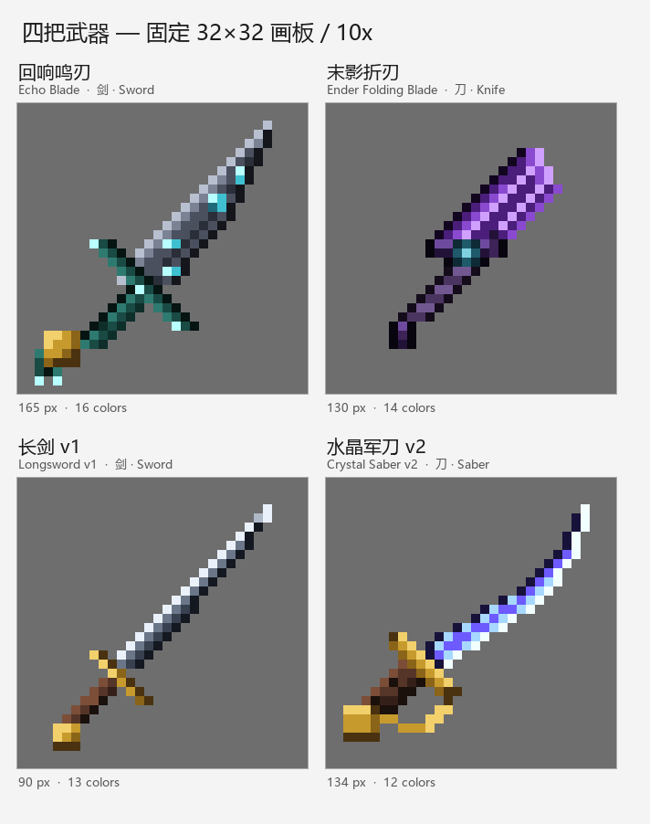

# 我的世界武器 Skill / Minecraft Weapon Skill

A 32×32 pixel-art toolkit for Minecraft weapons, plus the Fabric 1.21.1 weapon mod used to test it.



*The image shows four concepts drawn on a 32×32 board: Echo Blade, Ender Folding Blade, Longsword v1, and Crystal Saber v2. The materials in this image are deepslate/echo/sculk with gold fittings for Echo Blade, ender/obsidian/leather with a dim pearl accent for Ender Folding Blade, steel/gold/leather for Longsword v1, and crystal/gold/leather for Crystal Saber v2. These are the materials used here, not a required palette. The playable weapons are listed below.*

## The skill

The skill lives in [`skill/minecraft-weapon-pixel-art/`](skill/minecraft-weapon-pixel-art/). It is a set of tools and default notes, not a style rulebook.

- `SKILL.md` — 32×32 board workflow, proportion references, material notes, common observations, and a delivery check.
- `scripts/board.py` — `init` / `render` / validation; writes a single `review.png` with 8x light/dark/mid, GUI 16px, and silhouette panels.
- `assets/palette.json` — steel, deepslate, echo, sculk, copper, redstone, honey, amber, crystal, ender, amethyst, magnetite, obsidian, tidal, prismarine, shell, seaweed, blaze, gold, wood, and leather ramps.
- `templates/crystal_saber.json` — the proportion skeleton used by the example.
- `examples/crystal_saber_v2.json` — the one worked example: 134 visible pixels, 12 colors, bbox `[2,3,28,28]`.
- `examples/crystal_saber_v2.png` — an 8× preview of the example.

Quick start:

```bash
python skill/minecraft-weapon-pixel-art/scripts/board.py init \
  --out spec.json --primary steel --grip wood --name my_weapon

python skill/minecraft-weapon-pixel-art/scripts/board.py render \
  --spec spec.json --out candidate.png --preview-dir . --fast
```

Read `review.png`, work on the silhouette first, then paint the materials. For a finished spec to compare against, open `examples/crystal_saber_v2.json`. Final render without `--fast`.

## The mod

A Fabric 1.21.1 weapon mod with hand-authored pixel-art sprites and custom combat abilities.

- Nine playable weapons in the **Weapon / 武器** creative tab.
- Custom right-click abilities: charge lunge, double reap, triple wind blade, blink strike.
- Animated sprites for Blaze Sword, Storm Greatsword, Hell Sickle, and Dark Tachi.
- A training dummy for damage testing.

Current weapons:

Iron Rapier · Venom Rapier · Alloy Sword · Blaze Sword · Greatsword · Sickle · Hell Sickle · Storm Greatsword · Dark Tachi

Plus the Training Dummy test tool. See [docs/WEAPONS.md](docs/WEAPONS.md) for stats, recipes, and ability details.

## Build

Requires Java 21.

```bash
./gradlew build
```

Windows:

```bat
gradlew.bat build
```

The jar is written to `build/libs/weapon-1.0.0.jar`. Drop it into the instance's `mods/` folder and restart the game.

## Art notes

The palette, template/example, validation checks, and design notes are in [docs/minecraft-weapon-art-resources.md](docs/minecraft-weapon-art-resources.md).

## License

No license has been added yet. Add one before redistributing or reusing the code or art.
